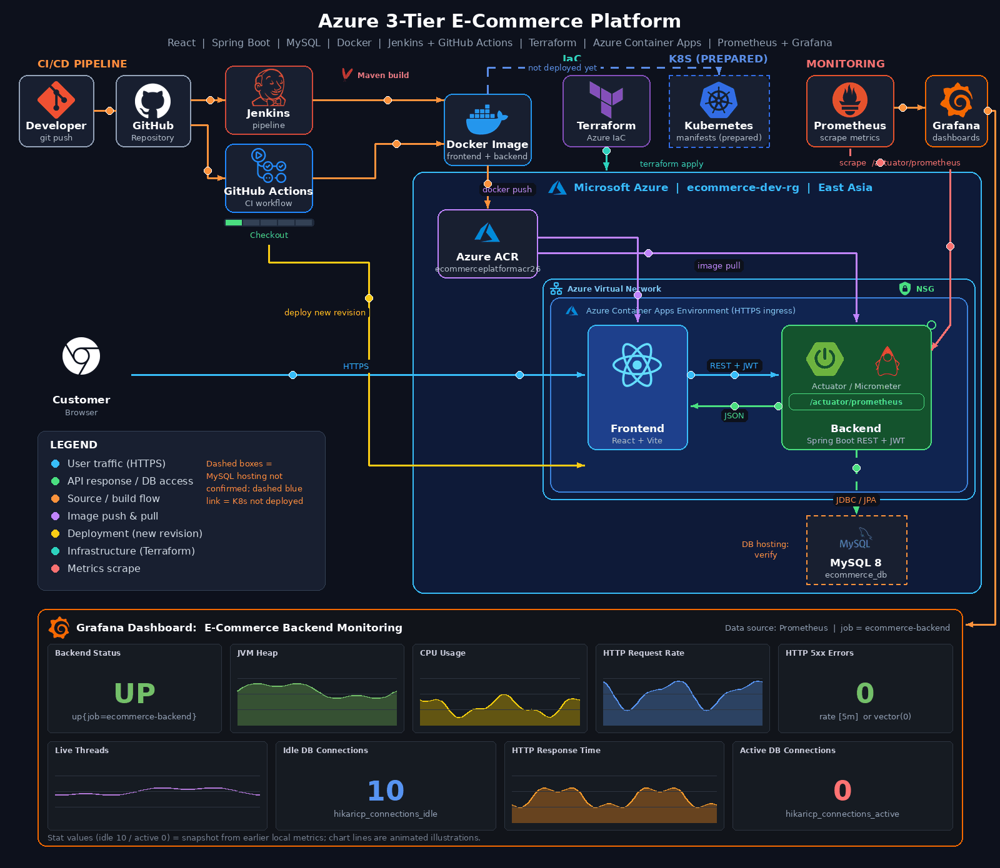
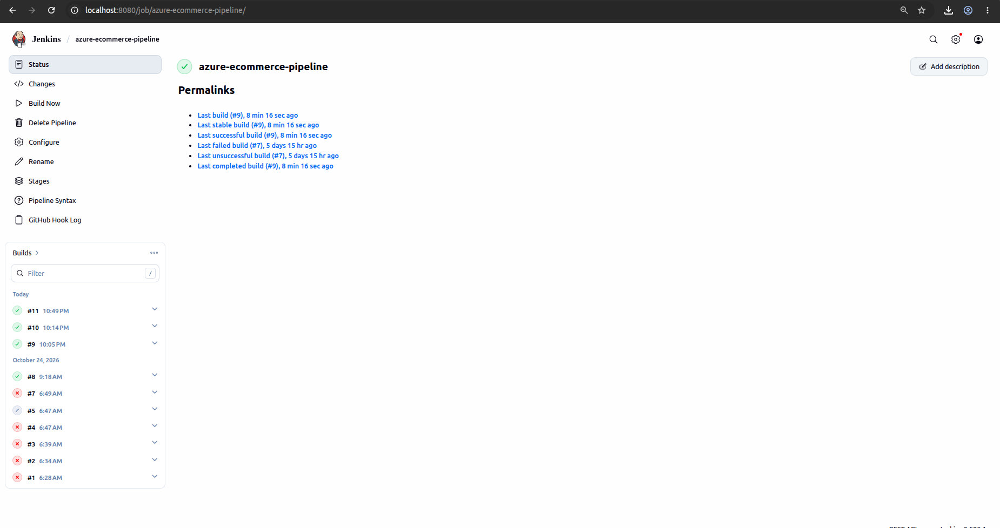

# Azure E-Commerce Platform

<p align="center">
  <strong>A Full-Stack E-Commerce Application with DevOps and Cloud Infrastructure</strong>
</p>

<p align="center">
  React | Spring Boot | MySQL | Docker | Jenkins | GitHub Actions | Kubernetes | Terraform | Azure | Prometheus | Grafana
</p>

---

## 1. Project Overview

The **Azure E-Commerce Platform** is a full-stack e-commerce application developed using React, Spring Boot, and MySQL.

The platform provides customer and administrator functionalities, including user authentication, product management, shopping cart management, order processing, and category management.

Alongside application development, this project demonstrates practical DevOps and cloud engineering concepts through containerization, CI/CD automation, infrastructure as code, Kubernetes configurations, and application monitoring.

The project aims to demonstrate how a modern web application can be developed, packaged, built, monitored, and prepared for cloud deployment using industry-relevant technologies.

### Project Objectives

- Develop a full-stack e-commerce application.
- Implement secure REST APIs using Spring Boot.
- Implement JWT-based authentication and role-based authorization.
- Containerize frontend and backend applications using Docker.
- Automate application builds using GitHub Actions and Jenkins.
- Define cloud infrastructure using Terraform.
- Prepare Kubernetes deployment configurations.
- Integrate Prometheus and Grafana for monitoring and observability.

---

## 2. System Architecture

The application follows a three-tier architecture consisting of the presentation, application, and data layers.



### Architecture Components

| Layer | Technology | Responsibility |
|---|---|---|
| Presentation Layer | React, Vite, Nginx | User interface and frontend delivery |
| Application Layer | Java, Spring Boot | Business logic and REST APIs |
| Data Layer | MySQL | Persistent application data |
| Containerization | Docker | Application containerization |
| CI/CD | GitHub Actions, Jenkins | Automated builds and integration |
| Orchestration | Kubernetes | Container deployment configurations |
| Infrastructure | Terraform, Azure | Cloud infrastructure provisioning |
| Monitoring | Prometheus, Grafana | Metrics collection and visualization |

---

## 3. Technology Stack

### Frontend

| Technology | Version / Details | Purpose |
|---|---|---|
| React | 18.3.1 | Frontend development |
| Vite | 5.4.x | Development and production builds |
| JavaScript | ES Modules | Frontend programming |
| React Router DOM | 6.26.2 | Client-side routing |
| Axios | 1.7.x | REST API communication |
| React Hot Toast | 2.4.1 | User notifications |
| Nginx | Alpine | Frontend web server |

### Backend

| Technology | Version / Details | Purpose |
|---|---|---|
| Java | 17 | Backend programming |
| Spring Boot | 4.1.1 | Backend framework |
| Spring Data JPA | Spring Boot managed | Database operations |
| Hibernate | Spring Boot managed | ORM |
| Spring Security | Spring Boot managed | Application security |
| JWT | 0.12.6 | Token-based authentication |
| Lombok | Maven dependency | Boilerplate reduction |
| Swagger / OpenAPI | Springdoc 3.1.1 | API documentation |
| BCrypt | Spring Security | Password encoding |
| Maven | Maven Wrapper | Build automation |

### Database

- MySQL 8
- Spring Data JPA
- Hibernate ORM

### DevOps and Cloud

| Technology | Purpose |
|---|---|
| Git and GitHub | Version control |
| GitHub Actions | CI automation |
| Jenkins | CI pipeline |
| Docker | Containerization |
| Docker Compose | Multi-container application configuration |
| Kubernetes | Container orchestration configurations |
| Terraform | Infrastructure as Code |
| Microsoft Azure | Cloud infrastructure platform |
| Prometheus | Metrics collection |
| Grafana | Monitoring dashboards |
| Spring Boot Actuator | Application health and metrics |

---

## 4. Application Features

### Customer Features

- User registration.
- User login.
- Browse available products.
- Search products.
- View product details.
- Browse product categories.
- Add products to shopping cart.
- Update cart item quantities.
- Remove products from cart.
- Clear shopping cart.
- Place orders.
- View order information.
- Cancel orders.

### Administrator Features

- Admin authentication and authorization.
- Admin dashboard.
- Product management.
- Category management.
- User management.
- Update user account status.
- Manage user roles.
- View all customer orders.
- Update order statuses.

### Security Features

- JWT-based authentication.
- Stateless authentication.
- Role-based access control.
- ADMIN and CUSTOMER roles.
- BCrypt password encoding.
- Protected REST API endpoints.
- Spring Security filter chain.
- Custom JWT authentication filter.

---

## 5. Application Screenshots

### Customer Interface

#### Customer Login


#### Customer Registration


#### Customer Dashboard and Products


### Administrator Interface

#### Admin Dashboard


#### Product Management


#### Category Management


#### User Management


---

## 6. Backend REST API Documentation

The backend exposes RESTful APIs for authentication, users, products, categories, shopping carts, and orders.

### Base URL

```text
http://localhost:8080
```

### 6.1 Authentication APIs

| HTTP Method | Endpoint | Description |
|---|---|---|
| POST | `/api/auth/register` | Register a new user |
| POST | `/api/auth/login` | Authenticate a user |

### 6.2 Product APIs

| HTTP Method | Endpoint | Description |
|---|---|---|
| GET | `/api/products` | Retrieve products |
| GET | `/api/products/{id}` | Retrieve a product by ID |
| GET | `/api/products/search` | Search products |
| POST | `/api/products` | Create a product |
| PUT | `/api/products/{id}` | Update a product |
| DELETE | `/api/products/{id}` | Delete a product |

### 6.3 Category APIs

| HTTP Method | Endpoint | Description |
|---|---|---|
| GET | `/api/categories` | Retrieve categories |
| GET | `/api/categories/{id}` | Retrieve a category |
| POST | `/api/categories` | Create a category |
| PUT | `/api/categories/{id}` | Update a category |
| DELETE | `/api/categories/{id}` | Delete a category |

### 6.4 Shopping Cart APIs

| HTTP Method | Endpoint | Description |
|---|---|---|
| GET | `/api/cart` | Retrieve shopping cart |
| POST | `/api/cart/items` | Add an item to cart |
| PUT | `/api/cart/items/{productId}` | Update cart item |
| DELETE | `/api/cart/items/{productId}` | Remove cart item |
| DELETE | `/api/cart` | Clear shopping cart |

### 6.5 Order APIs

| HTTP Method | Endpoint | Description |
|---|---|---|
| POST | `/api/orders` | Place an order |
| GET | `/api/orders` | Retrieve customer orders |
| GET | `/api/orders/admin` | Retrieve all orders |
| GET | `/api/orders/{orderId}` | Retrieve order details |
| PUT | `/api/orders/{orderId}/cancel` | Cancel an order |
| PUT | `/api/orders/admin/{orderId}/status` | Update order status |

### 6.6 User Management APIs

| HTTP Method | Endpoint | Description |
|---|---|---|
| GET | `/api/users/admin` | Retrieve users |
| PUT | `/api/users/admin/{userId}/status` | Update user status |
| PUT | `/api/users/admin/{userId}/role` | Update user role |

### Swagger / OpenAPI

Swagger UI is configured for interactive API documentation.

When the backend is running, access:

```text
http://localhost:8080/swagger-ui/index.html
```

---

## 7. Database Design

The application uses MySQL as its relational database and Spring Data JPA with Hibernate for object-relational mapping.

### Database Name

```text
ecommerce_db
```

### Main Database Entities

| Entity | Description |
|---|---|
| User | Stores user information |
| Role | Defines user roles |
| Product | Stores product information |
| Category | Organizes products |
| Cart | Represents a customer's shopping cart |
| CartItem | Stores products added to a cart |
| Order | Stores customer orders |
| OrderItem | Stores individual order items |
| OrderStatus | Represents order status values |

### Entity Relationships

- User and Cart: One-to-One.
- Cart and CartItem: One-to-Many relationship, represented through the CartItem owning side.
- CartItem and Product: Many-to-One.
- User and Order: Many-to-One from the Order side.
- Order and OrderItem: One-to-Many relationship, represented through the OrderItem owning side.
- OrderItem and Product: Many-to-One.
- Product and Category: Many-to-One.

### Database Configuration

The current local application configuration uses:

| Property | Value |
|---|---|
| Database | MySQL |
| Database Name | ecommerce_db |
| Local Host | localhost |
| Port | 3306 |
| Hibernate DDL Mode | update |
| SQL Logging | Enabled |

Database credentials should be configured securely and must not be committed to the repository.

---

## 8. Application Security

Spring Security and JWT are used to secure backend REST APIs.

### Authentication Flow

1. A user registers or logs in.
2. The backend authenticates the user.
3. JWT-based authentication is used for subsequent protected requests.
4. The custom JWT authentication filter processes incoming requests.
5. Spring Security checks the user's assigned role and permissions.

### Role-Based Authorization

| Functionality | ADMIN | CUSTOMER |
|---|---|---|
| Browse Products | Yes | Yes |
| Create Products | Yes | No |
| Update Products | Yes | No |
| Delete Products | Yes | No |
| Browse Categories | Yes | Yes |
| Manage Categories | Yes | No |
| Manage Shopping Cart | Yes | Yes |
| Access Customer Orders | Yes | Yes |
| Access Admin Orders | Yes | No |
| Manage Users | Yes | No |

The application uses stateless session management and BCrypt password encoding.

---

## 9. Docker Containerization

Docker is used to package the frontend and backend applications into containers.

### Backend Dockerfile

The backend Dockerfile uses:

- Eclipse Temurin Java 17 Alpine image.
- Spring Boot executable JAR.
- Container port 8080.

### Frontend Dockerfile

The frontend Dockerfile uses:

- Node.js 20 Alpine for building the React application.
- Nginx Alpine for serving the production build.
- Multi-stage Docker build.

An additional Azure-oriented Dockerfile is available at:

```text
ecommerce-frontend/Dockerfile.azure
```

### Docker Compose

The root `docker-compose.yml` defines the frontend and backend services.

| Service | Container Port | Host Port |
|---|---:|---:|
| Backend | 8080 | 8081 |
| Frontend | 80 | 5173 |

The current Docker Compose configuration:

- Runs the backend container.
- Runs the frontend container.
- Connects both services through an external Docker network.
- Uses an existing MySQL instance running on the host.
- Reads the database password from the `DB_PASSWORD` environment variable.

**Note:** MySQL is not defined as a Docker Compose service in the current configuration.

---

## 10. CI/CD Automation

The project uses GitHub Actions and Jenkins to automate application integration and build processes.

### 10.1 GitHub Actions

Workflow file:

```text
.github/workflows/ci.yml
```

The workflow is triggered by:

- Push events to the main branch.
- Pull requests targeting the main branch.

#### Configured Jobs

**1. Backend Tests**

- Checks out the repository.
- Sets up Java 17.
- Uses Maven dependency caching.
- Runs backend tests using Maven.

**2. Frontend Build**

- Sets up Node.js 20.
- Installs dependencies using `npm ci`.
- Builds the frontend using `npm run build`.

**3. Backend Docker Build**

- Packages the backend application.
- Builds the backend Docker image.

**4. Frontend Docker Build**

- Builds the frontend Docker image.

The Docker build jobs create images on the GitHub Actions runner. The current workflow does not include a registry push or Azure deployment step.

### 10.2 Jenkins Pipeline

The Jenkins pipeline is defined in:

```text
Jenkinsfile
```

#### Configured Pipeline Stages

1. Checkout
2. Check Project Files
3. Backend Build
4. Frontend Build

#### Backend Build

- Uses Java 17.
- Builds the Spring Boot application using Maven.
- Packages the backend application.

#### Frontend Build

- Installs dependencies.
- Executes the Vite production build.

#### Jenkins Build Result

The verified Jenkins Build #13 completed successfully.

**Build Status: SUCCESS**

Note: The current Jenkins backend build command uses `-DskipTests`, so backend tests are skipped in this pipeline.

### Jenkins Screenshot



---

## 11. Kubernetes Container Orchestration

The repository contains Kubernetes manifests in two directories.

## 11. Kubernetes Container Orchestration

The application has been successfully deployed to a local Kubernetes cluster using Minikube.

The project includes Kubernetes manifests for deploying and managing the frontend and backend containers.

### 11.1 Kubernetes Configuration Files

The repository contains Kubernetes manifests in two directories.

**Local Kubernetes Configuration**

Directory:

```text
k8s/
```

Contains:
- Backend Deployment.
- Backend NodePort Service.
- Local backend Docker image configuration.
- Host-based MySQL database connection configuration.

**Kubernetes Application Configuration**

Directory:

```text
kubernetes/
```

Contains:

| File | Description |
|---|---|
| backend-deployment.yaml | Backend Deployment |
| backend-service.yaml | Backend Service |
| frontend-deployment.yaml | Frontend Deployment |
| frontend-service.yaml | Frontend Service |

Additional configurations include:
- Backend readiness probe.
- Backend liveness probe.
- Container port configuration.
- Kubernetes Secret reference for database credentials.
- Frontend NodePort Service configuration.

### 11.2 Verified Local Minikube Deployment

The React frontend and Spring Boot backend have been successfully deployed and verified on a local Minikube Kubernetes cluster.

**Deployment Environment:**

| Component | Details |
|---|---|
| Kubernetes Distribution | Minikube |
| Kubernetes Version | v1.35.1 |
| Cluster Node | minikube |
| Environment | Local Development |

**Deployment Status:**

| Component | Kubernetes Resource | Status |
|---|---|---|
| Backend | Deployment | Running (1/1) |
| Backend | Pod | Running (1/1) |
| Frontend | Deployment | Running (1/1) |
| Frontend | Pod | Running (1/1) |

**Kubernetes Services:**

| Service | Type | NodePort |
|---|---|---|
| ecommerce-backend | NodePort | 32442 |
| ecommerce-frontend | NodePort | 30080 |

### 11.3 Deployment Verification

The following deployment checks were successfully completed:

- Verified Minikube cluster availability.
- Verified Kubernetes node status as Ready.
- Verified backend and frontend deployments.
- Verified both application pods are running.
- Verified Kubernetes NodePort services.
- Successfully accessed the frontend through the Minikube NodePort.
- Successfully accessed the backend health endpoint through its NodePort.
- Verified Spring Boot Actuator health status.

**Backend Health Check:**

Endpoint:

```text
http://<MINIKUBE-IP>:32442/actuator/health
```

Verified response:

```json
{
  "groups": [
    "liveness",
    "readiness"
  ],
  "status": "UP"
}
```

**Application Access:**

| Component | Access URL |
|---|---|
| Frontend | `http://<MINIKUBE-IP>:30080` |
| Backend Health | `http://<MINIKUBE-IP>:32442/actuator/health` |

Replace `<MINIKUBE-IP>` with the IP address returned by:

```bash
minikube ip
```

**Note:** This is a verified local Minikube deployment. It is not an Azure Kubernetes Service (AKS) deployment.

## 12. Infrastructure as Code – Terraform

Terraform is used to define Azure infrastructure resources.

Configuration directory:

```text
terraform/environments/dev/
```

### Configured Azure Resources

| Resource | Description |
|---|---|
| Azure Resource Group | Groups project resources |
| Virtual Network | Provides network isolation |
| AKS-designated Subnet | Subnet reserved in configuration for AKS-related networking |
| Application Subnet | Application network segment |
| Network Security Group | Network security configuration |
| Subnet NSG Association | Associates the application subnet with the NSG |

### Network Configuration

| Component | Configuration |
|---|---|
| Virtual Network | vnet-ecommerce-dev |
| Address Space | 10.10.0.0/16 |
| AKS-designated Subnet | 10.10.1.0/24 |
| Application Subnet | 10.10.2.0/24 |

### Terraform Provider

The project uses:

```hcl
source  = "hashicorp/azurerm"
version = "~> 4.0"
```

The Terraform configuration defines Azure networking infrastructure.

**Note:** The currently verified Terraform configuration does not define an Azure Kubernetes Service cluster resource.

---

## 13. Azure Configuration

The project includes Azure-oriented application configuration.

### Azure Frontend Configuration

Files:

```text
ecommerce-frontend/Dockerfile.azure
ecommerce-frontend/nginx.azure.conf
```

The Azure frontend Dockerfile:

- Builds the React application using Node.js 20 Alpine.
- Uses Nginx Alpine as the production web server.
- Copies the frontend production build into the Nginx directory.
- Includes an Azure-specific Nginx configuration.

The Nginx configuration provides:

- Frontend static file serving.
- React single-page application routing.
- API reverse proxy configuration to the backend Container Apps endpoint.

### Azure Container Registry

The project has also used Azure Container Registry to store container images.

The backend image was previously built and pushed to the configured registry.

Azure resources and deployment configurations should be checked before assuming that a deployment endpoint is currently active.

---

## 14. Monitoring and Observability

The project includes an application monitoring stack using Spring Boot Actuator, Micrometer, Prometheus, and Grafana.

### Monitoring Architecture

| Component | Responsibility |
|---|---|
| Spring Boot Actuator | Exposes application health and metrics endpoints |
| Micrometer | Provides application metrics integration |
| Prometheus | Collects and stores metrics |
| Grafana | Visualizes metrics through monitoring dashboards |

### Monitoring Features

- Backend application health monitoring.
- Prometheus metrics integration.
- Application metrics visualization.
- Database connection monitoring.
- Active database connection monitoring.
- Idle database connection monitoring.
- Grafana monitoring dashboards.

### Actuator Endpoints

The backend exposes the following management endpoints:

```text
/actuator/health
/actuator/info
/actuator/prometheus
```

### Monitoring Screenshots

#### Prometheus Monitoring


#### Grafana Backend Monitoring Dashboard


#### Database Connection Monitoring


#### Active Database Connections


#### Idle Database Connections


---

## 15. Local Development Setup

Follow these steps to run the application locally.

### Prerequisites

Install the following software:

- Java 17
- Node.js 20
- npm
- MySQL 8
- Git
- Docker (optional)

### Step 1: Clone the Repository

```bash
git clone https://github.com/Hirunodhya2003/azure-ecommerce-platform.git

cd azure-ecommerce-platform
```

### Step 2: Create the Database

Open MySQL and execute:

```sql
CREATE DATABASE ecommerce_db;
```

### Step 3: Configure Backend Database Connection

Open:

```text
backend/ecommerce-backend/src/main/resources/application.properties
```

Configure the following properties according to your local MySQL environment:

```properties
spring.datasource.url=jdbc:mysql://localhost:3306/ecommerce_db
spring.datasource.username=YOUR_MYSQL_USERNAME
spring.datasource.password=${DB_PASSWORD}
```

Set the `DB_PASSWORD` environment variable before starting the application.

Do not commit actual database passwords or other secrets to GitHub.

### Step 4: Run the Backend

Open a terminal:

```bash
cd backend/ecommerce-backend
```

Build the application:

```bash
./mvnw clean package -DskipTests
```

Start the Spring Boot application:

```bash
./mvnw spring-boot:run
```

The backend will be available at:

```text
http://localhost:8080
```

### Step 5: Run the Frontend

Open another terminal from the repository root:

```bash
cd ecommerce-frontend
```

Install dependencies:

```bash
npm ci
```

Start the frontend development server:

```bash
npm run dev
```

Open the local URL displayed in the terminal by Vite.

---

## 16. Project Directory Structure

```text
azure-ecommerce-platform/
│
├── backend/
│   └── ecommerce-backend/
│       ├── src/
│       │   └── main/
│       │       ├── java/
│       │       └── resources/
│       ├── pom.xml
│       ├── mvnw
│       └── Dockerfile
│
├── ecommerce-frontend/
│   ├── public/
│   ├── src/
│   ├── package.json
│   ├── package-lock.json
│   ├── Dockerfile
│   ├── Dockerfile.azure
│   ├── nginx.conf
│   └── nginx.azure.conf
│
├── docs/
│   ├── architecture/
│   │   └── architecture.gif
│   │
│   └── screenshots/
│       ├── admin/
│       ├── ci-cd/
│       ├── customer/
│       └── monitoring/
│
├── .github/
│   └── workflows/
│       └── ci.yml
│
├── k8s/
│   ├── deployment.yaml
│   └── service.yaml
│
├── kubernetes/
│   ├── backend-deployment.yaml
│   ├── backend-service.yaml
│   ├── frontend-deployment.yaml
│   └── frontend-service.yaml
│
├── terraform/
│   └── environments/
│       └── dev/
│
├── docker-compose.yml
├── Jenkinsfile
└── README.md
```

---

## 17. Future Improvements

Potential improvements for future development:

- Complete automated Azure deployment through CI/CD.
- Provision managed Kubernetes infrastructure using Terraform.
- Improve automated integration and end-to-end testing.
- Implement centralized logging.
- Improve production-ready secrets management.
- Enhance monitoring and alerting.
- Implement automated backup and recovery strategies.
- Improve scalability and high availability.

---

## 18. Learning Outcomes

Through this project, the following practical concepts are demonstrated:

- Full-stack application development.
- REST API development using Spring Boot.
- JWT authentication and role-based authorization.
- Relational database design and ORM.
- Docker image creation and containerization.
- Multi-container application configuration.
- CI/CD pipeline automation.
- Jenkins pipeline configuration.
- GitHub Actions workflow automation.
- Kubernetes deployment configuration.
- Terraform-based infrastructure provisioning.
- Azure cloud infrastructure concepts.
- Prometheus metrics integration.
- Grafana dashboard monitoring.

---

## 19. Author

**Hirunodhya**

GitHub: `Hirunodhya2003`

Project: **Azure E-Commerce Platform**

Repository: `azure-ecommerce-platform`

---

<p align="center">
  <strong>Built to demonstrate Full-Stack Development, DevOps Automation, Cloud Infrastructure, and Monitoring.</strong>
</p>

<p align="center">
  ⭐ If you find this project useful, consider giving the repository a star!
</p>
